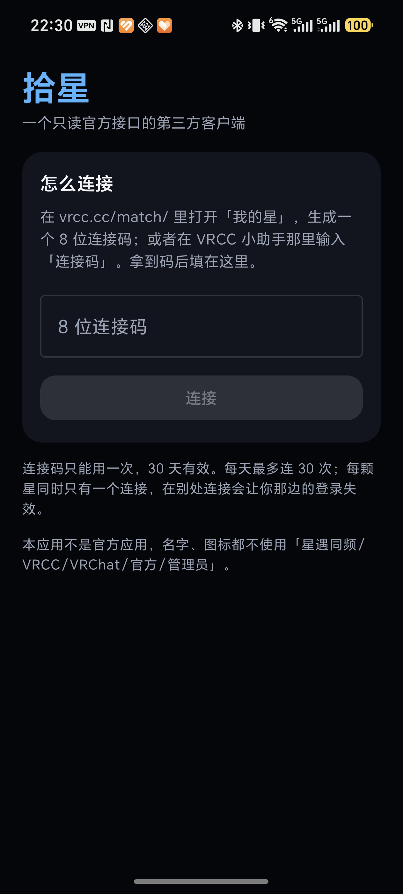

# 拾星 · Android 客户端

星遇同频（vrcc.cc）的第三方 Android 客户端。**只使用官方开放的 `/api/v1`**，不复刻网页端的未公开接口。

> 本应用不是官方应用。名字、图标、包名都不含「星遇同频」「VRCC」「VRChat」「官方」「管理员」等字样。

- 仓库：https://github.com/daa0v0/xingshi-app
- 客户端标识：`dev-shixing-android`（每个请求都带 `X-Client`）
- 许可：MIT

<p align="center">
  
</p>

## 能做什么

| 页面 | 数据来源 | 说明 |
| --- | --- | --- |
| 地图榜 | `GET /boards/maps` | 满 5 人评分才进榜；显示均分、评分人数、口碑档位 |
| 提醒 | `GET /me/notifications`、`GET /me/notifications/recent` | 最近一天的最后五条，可标记已读 |
| 星轨 | `GET /me/crossings` | 在同一个房间遇到的星，`why=hide` 时整块不显示 |
| 连上 | `GET /me/mutuals` | 互相连上的星，含对方公开的 VRChat 名字 |
| 地图评分 | `GET /me/maps/{world}`、`POST /me/maps/{world}/rating` | 1–10 星 + 30 字短评，**只在玩家点提交时写** |
| 我的 | — | 星号、本地日配额用量、断开连接（从本机删除令牌） |

连接方式：在网页端「我的星」里生成 8 位连接码，填进 App；令牌只存在这台设备上，只发往 `vrcc.cc`。

## 不能做什么（官方接口没开）

测星问卷、每日推荐、星友圈动态、私聊、连线留言、地图榜之外的礼物/装扮/背包、星搭——这些都在未公开的 `/api/match` 上，官方《使用要求》写的是「新的客户端请一律使用 `/api/v1/`」，所以这里不做。改资料、注销账号也不在接口范围里，请回网页端。

## 合规清单（对着官方要求逐条落）

- **登记**：客户端标识 `dev-shixing-android`（`BuildConfig.CLIENT_ID`），每请求都带 `X-Client`。
- **只走官方接口**：`VrccClient` 里 `require(!path.startsWith("http"))` 硬拦绝对地址，基址写死 `https://vrcc.cc/api/v1/`。
- **限流**：`Throttle` 每分钟 120 次上限 + 每个接口的最小间隔；四个个人接口合计每天 300 次，在 `TokenStore.takeDailyQuota()` 里本地先扣，宁可少问。
- **写操作只在点击时**：打分只能从评分弹窗的「提交」按钮发出，不做后台批量。
- **令牌**：只存本机 DataStore，只发给 `vrcc.cc`，断开即删；不转存、不上传。
- **权限**：只申请 `INTERNET`、`ACCESS_NETWORK_STATE`、`POST_NOTIFICATIONS`。
- **只给本人看**：所有数据只渲染给当前连接的星，没有分享/导出/统计上报。
- **开源**：本仓库（`https://github.com/daa0v0/xingshi-app`），App 里 `BuildConfig.SOURCE_URL` 指向同一地址。

## 构建

```bash
# 需要 JDK 17+ 与 Android SDK（compileSdk 34）
cd native
./gradlew assembleDebug        # Windows: .\gradlew.bat assembleDebug
adb install -r app/build/outputs/apk/debug/app-debug.apk
```

正式包（R8 压缩，约 1.5 MB）：

```bash
./gradlew assembleRelease
adb install -r app/build/outputs/apk/release/app-release.apk
```

单元测试用 MockWebServer 钉住契约（`X-Client` 头、相对路径、错误码 `need`）：

```bash
gradle testDebugUnitTest
```

## 代码结构

```
app/src/main/java/app/shixing/client/
├── MainActivity.kt          单 Activity，edge-to-edge
├── ShixingApplication.kt    组装 Repository
├── data/
│   ├── Models.kt            /api/v1 的返回形状（@Serializable）
│   ├── VrccClient.kt        唯一出口，负责头、令牌、错误解析
│   ├── TokenStore.kt        DataStore：令牌、游标、本地日配额
│   ├── Throttle.kt          每分钟限流 + 每接口最小间隔
│   └── Repository.kt        把限流/配额/存储收成一层
├── notify/
│   └── ReminderNotifier.kt  通知渠道与通知内容（不发请求）
├── work/
│   ├── ReminderWorker.kt    后台增量拉取 + 配额/退避
│   └── ReminderScheduler.kt 每 15 分钟登记一次
└── ui/
    ├── MainViewModel.kt     状态 + 错误翻译
    ├── ShixingApp.kt        5 个页面 + 评分弹窗
    └── theme/Theme.kt       深色配色，对齐站点 #05060A / #4DB4FF
```

## 路线图

- [x] P0 工程与主题
- [x] P1 数据层（客户端、令牌、限流、配额）
- [x] P2 五个页面 + 评分
- [x] P3 后台提醒（WorkManager 每 15 分钟增量拉，见下）
- [ ] P4 网页登录兜底（WebView 只用于过 Turnstile，拿不到就引导扫码连接）
- [ ] P5 上架材料 / 开源仓库 / 登记 Issue

## 后台提醒怎么工作

`ReminderWorker` 每 15 分钟（系统允许的最小周期）用一次 `GET /me/notifications?since=<游标>`，只取增量：

- 首次运行只记基线，不弹历史提醒；
- 每次先扣本地日配额，扣不到就跳过（后台 15 分钟 ≈ 每天 96 次，给前台刷新留余量）；
- 只把 `id > 游标` 的条目合成一条通知，点开回到 App；
- 遇到 `429 too_soon` 退避重试，遇到 `gone`（令牌被别处顶掉）弹一次「连接已失效」后静默。

官方文档建议按返回的 `every`（60 秒）轮询——那是网页端前台的节奏；后台照做会把电池和每天 300 次的配额一起烧掉，所以这里刻意放慢。

## 已知限制

- 没有 Web Push：后台提醒是 15 分钟一轮的增量拉取，不是实时推送。
- 星轨的 `intro` 只有前 60 字，原文要回网页端看。
- 连接码用一次就失效，每天最多连 30 次；每颗星同时只有一个连接，在别处连接会让这边的登录失效。
